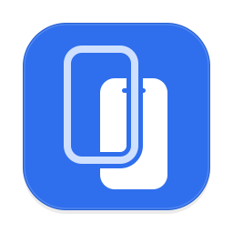
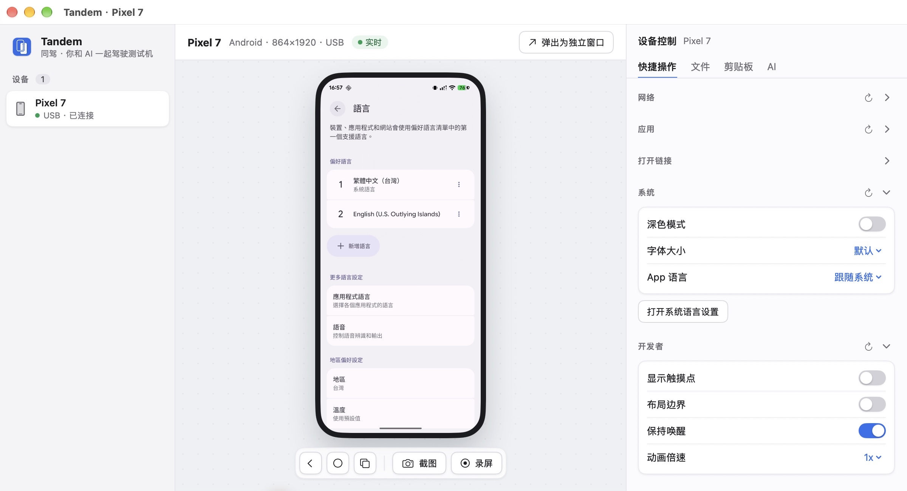
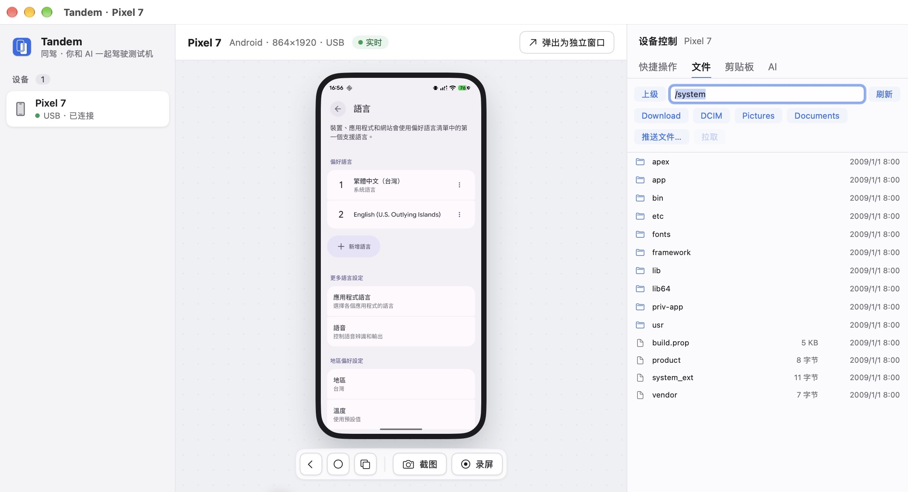
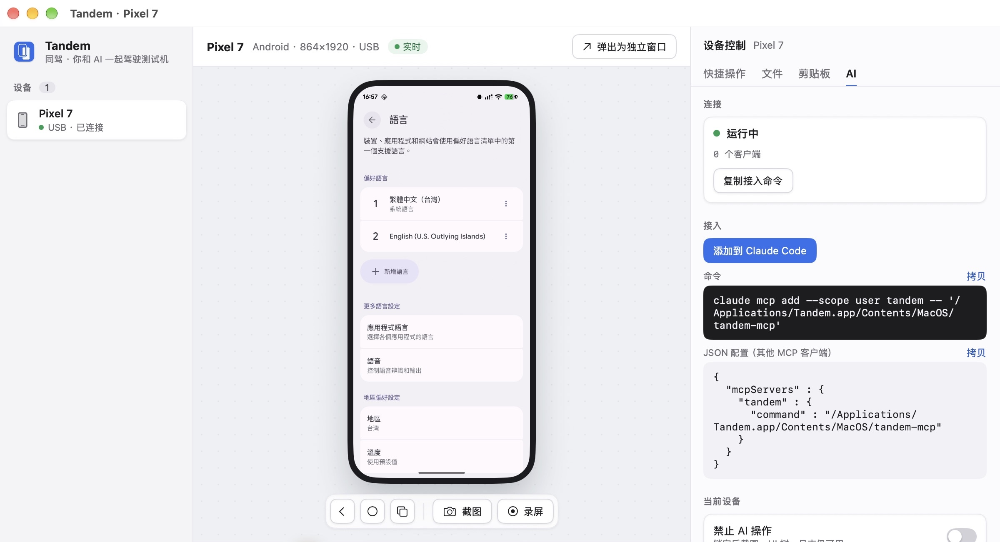

<p align="center">
  
</p>

<h1 align="center">Tandem（同驾）</h1>

<p align="center">在 Mac 上投屏操控 Android、iOS 模拟器和 iPhone USB 真机（实验），让 AI 和你操作同一台设备。</p>

<p align="center">
  <a href="https://github.com/Petterpx/Tandem/releases/latest"></a>
  <a href="https://github.com/Petterpx/Tandem/actions/workflows/release.yml"></a>
  
  <a href="LICENSE"></a>
</p>

---

## 实际界面

Tandem 0.2.0 在 macOS 上连接 Pixel 7（USB）的实际运行截图。画面中的 Android 页面为系统语言设置；截图裁去了窗口底部的历史截图与操作记录区域。

**投屏工作台与快捷操作**：左侧选择设备，中间实时投屏，右侧集中管理系统设置和开发者选项。



<details>
<summary>查看文件浏览与 AI 接入界面</summary>

**文件浏览**：查看设备目录，提供推送与拉取入口。这里展示 Android 的 `/system` 目录。



**AI 接入**：查看 MCP 服务状态、复制接入命令或 JSON 配置。截图时服务正在运行，尚无客户端连接。



</details>

## 解决什么

调 Android 时，测试机在桌上来回拿；想让 AI 帮忙点一点、看一眼，又得另外给它配 adb、截图、输入，和你自己用的投屏工具互相抢设备。

Tandem 是一个 macOS 原生 App：一个窗口里投屏、操控、截图、看日志、装包；同时内置 MCP 服务，让 Claude Code 等 AI 客户端通过同一条设备连接操作这台手机。你看得到 AI 在做什么，也可以随时接手。

投屏基于 [scrcpy](https://github.com/Genymobile/scrcpy) 的 server（v5.0.1），Mac 端协议、解码与界面均为自行实现；设备通信通过 adb。

## 功能

- **投屏与控制**：USB 或 Wi-Fi adb 连接；鼠标、触摸板、键盘映射为触摸、滚动与按键；支持中文输入；多台设备可各自弹出独立窗口对照。
- **无线连接**：Android 11+ 扫码配对，或对 USB 设备一键转无线。
- **iOS 模拟器**：左栏「iOS 模拟器…」选择本机 Xcode 设备并启动；已启动设备自动发现。支持画面、点按/长按/拖动、Home 与编辑按键、文本、剪贴板、截图、录屏和打开链接。模拟器使用 H.264 硬件编解码，预览长边最多 1920、目标 60 fps，高清截图取原分辨率 PNG。
- **iOS 真机（实验）**：发布包包含 USB 驱动，支持画面、点按/拖动、中文/英文/emoji 整段输入、Home 与编辑键、投屏截图和录屏；目前仅验证 iOS 27 竖屏。通用剪贴板、UI 树和应用管理的范围见下面说明。
- **手机助手**：直接输入需求，通过 Codex 登录或自定义模型 API 操作当前设备；支持执行记录、停止和补充后继续。
- **截图与录屏**：截图默认取投屏画面（即时），按住 ⌥ 为无损高清截图；保存到可配置目录并复制到剪贴板；录屏输出 mp4。
- **剪贴板**：读取、写入、写入并粘贴，保留历史；可选双向自动同步（默认关闭）。
- **快捷操作**：网络开关（Wi-Fi / 移动数据 / 飞行模式）、应用管理（启动、强停、清数据、卸载）、打开链接 / Deeplink、系统设置（深色模式、字体大小、App 语言）、自定义 `adb shell` 命令按钮。面板只显示当前设备支持的功能。
- **文件传输与安装**：把文件拖入窗口推送到设备（`/sdcard/Download`），拖入 APK 直接安装；⌘V 粘贴 Mac 剪贴板里的文件或图片同样会推送。右栏「文件」标签可浏览设备目录、拉取到 Mac、推送。
- **日志窗口**：每台设备一个独立窗口，按包名跟踪 logcat，支持级别与关键字过滤、暂停、导出。
- **AI（MCP）**：内置 `tandem-mcp`，工具列表见下。

### MCP 工具

- 设备与观察：`list_devices`、`screenshot`、`get_ui_tree`、`wait_for`
- 输入：`tap`、`long_press`、`swipe`、`scroll`、`type_text`、`fill_text`、`press_key`
- 剪贴板：`get_clipboard`、`set_clipboard`
- 应用：`current_app`、`launch_app`、`force_stop`、`clear_app_data`、`uninstall_app`、`install_app`、`open_url`
- 网络与设置：`get_network_state`、`set_network`、`get_dev_options`、`set_dev_option`、`get_system_settings`、`set_system`
- 日志与文件：`get_logs`、`push_file`、`pull_file`
- 其他：`shell`

工具列表按设备能力动态生成。每台设备可在 App 的 AI 标签中单独「禁止 AI 操作」。

## 安装

1. 到 [Releases](https://github.com/Petterpx/Tandem/releases/latest) 下载 `Tandem-<版本>.zip`，解压后把 `Tandem.app` 拖到「应用程序」。可用同目录的 `.sha256` 校验：`shasum -a 256 -c Tandem-<版本>.zip.sha256`。
2. 首次打开会被 Gatekeeper 拦下（临时签名，未经 Apple 公证）。右键点击应用选「打开」，或到「系统设置 → 隐私与安全性」底部点「仍要打开」，或在终端执行：

   ```bash
   xattr -dr com.apple.quarantine /Applications/Tandem.app
   ```

要求：

- macOS 14 或更新
- 开启 USB 调试的 Android 设备（部分国产 ROM 还需额外打开「USB 调试（安全设置）」，App 会给出提示）
- iOS 模拟器控制另需 Apple Silicon Mac、macOS 15+、完整 Xcode 及已安装的 iOS 模拟器运行时；Android 仍支持 macOS 14+
- 发布包中的 iOS 真机实验支持另需 Apple Silicon Mac、iOS 27、开发者模式和兼容的开发者磁盘镜像（DDI），见下节；模拟器暂不提供 UI 树、按文字/元素点击、网络/系统设置、应用管理、文件和日志工具。AI 可截图后使用坐标操作，不支持的按键会明确返回错误

模拟器首次使用：在 Xcode 设置中安装 iOS 运行时；如提示开发者目录无效，使用 `xcode-select` 选中完整 Xcode。Tandem 内置模拟器 helper，无需安装 idb 命令行工具或启动额外服务。停止投屏会退出 helper，模拟器本身继续运行。

模拟器普通文字直接写入当前输入框，支持中文、emoji、换行及选区替换，不依赖模拟器的键盘语言，也不覆盖剪贴板；快速输入路径需要 iOS 17+。首次进入新的 App 可能有一次输入预热，后续连续输入通常为毫秒级。密码框使用系统粘贴回退，耗时较长；⌘V 仍按显式剪贴板操作处理。输入不确定是否生效时会明确失败，不会自动重复输入。积压的连续文字和相邻拖动位置会合并，保留按下、抬起、按键和粘贴的顺序。

### iOS 真机 USB 实验

这条路径使用 CoreDevice 原生 HEVC 视频与 UniversalHID 触摸，Mac 端原生解码，不依赖 FFmpeg；不需要在手机安装 App 或 XCTest Runner，也不启动常驻服务。需要 USB 连接、解锁并信任 Mac 的 iOS 27 设备，开启「开发者模式」，以及与系统兼容的完整 Xcode/DDI。首次连接可先在 Xcode 的 Devices and Simulators 中完成设备准备；开发者也可使用 `xcrun devicectl device info ddiServices --device DEVICE_UDID --auto-mount-ddis` 检查并挂载 DDI。

当前支持投屏、单指点按/长按/拖动、文字输入、Home、Enter、删除、Tab、方向键，以及基于投屏画面的截图和录屏。文字通过 CoreDevice 原生剪贴板写入后一次粘贴，支持中文、英文、emoji 和换行，不逐字点击软键盘；会覆盖手机剪贴板。先聚焦输入框，默认只填文字，不提交。单次最多 8192 UTF-8 字节，失败后不自动重复插入。Mac 键盘输入、⌘V 与 AI 共用该路径。

系统原图截图（⌥ 截图或 MCP `hq=true`）、通用剪贴板读取/同步、UI 树、网络/系统设置、文件和日志尚未提供。已在一台 iOS 27 真机验证视频与连续触控同时工作，以及中文/英文/emoji 实际输入；横屏、旋转、不同机型和长时间稳定性尚未完成验证，原型测得的帧率不代表所有设备或集成界面的性能保证。

支持通过 Xcode 原生接口读取应用名称/Bundle ID 并直接启动应用，目录共享缓存 60 秒；该能力独立于应用管理，不开放强停、清数据或卸载。助手首轮自动读取目录，避免回主页翻页找图标。`fill_text` 将聚焦输入框和整段输入合成一次调用；修改已有内容时 `replace: true` 先全选再粘贴，不逐字删除，默认不提交。刚粘贴后，本机 OCR 可识别明确的系统粘贴许可弹窗并点一次允许；识别不确定时交回正常截图流程。每步详情显示模型判断和工具执行分别耗时，App 内部导航当前仍依赖截图。

只有打包了 `tandem-ios-usb` helper 的构建才会启用该驱动；缺失 helper 不影响 Android 或 iOS 模拟器。开发时可通过 `TANDEM_IOS_USB_HELPER=/absolute/path/tandem-ios-usb` 指向单独构建的 helper。详细原型验证见 [Prototypes/IOSUSB](Prototypes/IOSUSB/README.md)。

## 接入 AI

在工作台右栏的 **AI → 手机助手** 中输入需求，点击「开始执行」。助手固定操作当前设备，每步读取截图、执行一个操作并检查新画面；可以随时「停止」。执行记录保留在当前 App 会话中；Codex 路线为 CLI 创建仅本用户可读的临时截图，每轮结束后清理。已明确联系人和内容的普通消息直接执行，不重复确认。确实需要补充信息或处理登录时，可以回复后「继续执行」，会保留成功步骤并重新观察画面。

「模型」支持两种来源：**Codex 登录**复用本机 `codex login`，需要支持 `exec --ignore-user-config`、图片输入与结构化输出的新版 CLI；**自定义模型 API**使用兼容 OpenAI 的 `/v1/chat/completions`，模型须支持图片输入和 `json_schema` 结构化输出。API Key 只存本机钥匙串；地址、模型等普通配置存本机偏好。每轮任务需求、当前截图、应用目录（支持时）和必要的操作记录会发给所选模型。

Codex 接入使用 CLI 的只读沙箱，忽略用户配置和规则并关闭已知工具功能；当前 CLI 请求仍包含内置工具包装，未保证移除全部 CLI 工具。手机操作由 App 校验并限定到选定设备；这不构成对 CLI 本身的额外权限隔离。

Tandem 常驻菜单栏，并在本机 Unix socket 上提供控制服务；`tandem-mcp` 是随 App 打包的 stdio MCP 桥接程序（位于 `Tandem.app/Contents/MacOS/tandem-mcp`），App 未运行时会自动在后台拉起。

在 **AI → 连接外部 AI** 中：

- 点击「添加到 Claude Code」，等同于执行 `claude mcp add --scope user tandem -- <tandem-mcp 路径>`（需要已安装 `claude` 命令）；
- 也可以拷贝页面里显示的命令，或把 JSON 配置粘贴到其他 MCP 客户端：

```json
{
  "mcpServers": {
    "tandem": { "command": "/Applications/Tandem.app/Contents/MacOS/tandem-mcp" }
  }
}
```

路径以 AI 标签里显示的为准（取决于 App 的安装位置）。同一标签页还会显示服务状态和已连接的客户端。

## 构建与发布

需要 Xcode（支持 Swift 6）与 [XcodeGen](https://github.com/yonaskolb/XcodeGen)。

Apple Silicon 构建时会自动编译 `Packages/SimulatorHelper` 并打包 `tandem-simulator`、iOS Simulator 文本 helper 及依赖。首次构建需要联网下载固定版本的 FBSimulatorControl 1.7.7；这部分独立要求 macOS 15+，不会提高主 App 的最低系统版本。文本 helper 仅随投屏会话运行，不安装到待测 App；会话退出时恢复其临时开启的模拟器辅助功能状态。

iOS 真机 USB helper 是额外的实验构建项：本地默认在 Cargo 可用时编译 Rust helper，首次需要联网获取固定版本的 MIT 许可 `idevice` 和 Cargo 依赖；缺 Cargo 或自动构建失败时给出 warning 并保留 Android/模拟器构建。可设置 `TANDEM_BUILD_IOS_USB_HELPER=0` 禁用，或安装 Rust 后设置为 `1` 强制启用（缺 Cargo 或构建失败会报错）。正式发布流程安装 Rust 并强制启用 USB helper，缺少 helper 或许可证文件时停止发布。打包包含 helper 与第三方许可声明，不包含原型查看器或 FFmpeg。

```sh
brew install xcodegen
scripts/fetch-vendor.sh   # 下载并校验 adb 与 scrcpy-server 到 App/Resources/Vendor/
xcodegen generate         # 生成 Tandem.xcodeproj
open Tandem.xcodeproj     # 在 Xcode 中运行，或使用下面的命令行构建
```

```sh
xcodebuild -project Tandem.xcodeproj -scheme Tandem -configuration Release \
  -destination 'platform=macOS' -derivedDataPath build CODE_SIGN_IDENTITY=- build
# 产物：build/Build/Products/Release/Tandem.app
```

测试：

```sh
# 核心库（无需设备；真机集成测试仅在设置 TANDEM_TEST_SERIAL 时运行）
cd Packages/TandemCore && swift test

# App 测试（DerivedData 请放在 ~/Documents 之外）
xcodebuild test -project Tandem.xcodeproj -scheme Tandem -destination 'platform=macOS' \
  -derivedDataPath "$HOME/Library/Developer/Xcode/DerivedData/Tandem-test"
```

模拟器原生集成测试默认跳过，可针对一台已启动的测试模拟器手动运行（只读取画面、剪贴板与截图，并验证会话退出）：

```sh
TANDEM_TEST_SIMULATOR=<UDID> \
TANDEM_SIMULATOR_HELPER=<Tandem.app绝对路径>/Contents/MacOS/tandem-simulator \
swift test --package-path Packages/TandemCore --filter IOSSimulatorLiveTests
```

发版：在 GitHub 上用 `v<版本号>` 作 tag 发布 Release。`.github/workflows/release.yml` 会自动获取依赖、跑 TandemCore 测试、构建，并把 `Tandem-<tag>.zip` 与 `.sha256` 上传到这个 Release。需要重跑时，在 Actions 页面手动运行 Release 工作流并填写 tag，产物会覆盖上传。

## License

Tandem 以 [GPL-3.0](LICENSE) 许可发布。

第三方组件由 `scripts/fetch-vendor.sh` 下载到 `App/Resources/Vendor/`（已被 git 忽略，随 App 打包），其许可证与声明文件一并保留：

- adb（Android platform-tools）：Apache-2.0，见 `NOTICE.txt`
- scrcpy-server：Apache-2.0，见 `LICENSE`
- iOS Simulator helper：使用 [Meta idb / FBSimulatorControl](https://github.com/facebook/idb)，固定为 1.7.7，许可证随 helper 一并打包；只在本机通过标准输入/输出通信。
- iOS USB helper（可选实验）：使用 MIT 许可的 [idevice](https://github.com/jkcoxson/idevice)，固定版本和声明见 [原型第三方说明](Prototypes/IOSUSB/Backend/THIRD_PARTY.md)；启用时许可随 helper 放入 `Contents/Resources/IOSUSBLicenses`。
