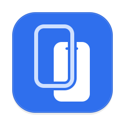

<p align="center">
  
</p>

<h1 align="center">Tandem（同驾）</h1>

<p align="center">在 Mac 上投屏操控 Android 测试机，Claude Code 通过 MCP 和你一起操作同一台设备。</p>

<p align="center">
  <a href="https://github.com/Petterpx/Tandem/releases/latest"></a>
  <a href="https://github.com/Petterpx/Tandem/actions/workflows/release.yml"></a>
  
  <a href="LICENSE"></a>
</p>

---

## 解决什么

调 Android 时，测试机在桌上来回拿；想让 AI 帮忙点一点、看一眼，又得另外给它配 adb、截图、输入，和你自己用的投屏工具互相抢设备。

Tandem 是一个 macOS 原生 App：一个窗口里投屏、操控、截图、看日志、装包；同时内置 MCP 服务，让 Claude Code 等 AI 客户端通过同一条设备连接操作这台手机。你看得到 AI 在做什么，也可以随时接手。

投屏基于 [scrcpy](https://github.com/Genymobile/scrcpy) 的 server（v5.0.1），Mac 端协议、解码与界面均为自行实现；设备通信通过 adb。

## 功能

- **投屏与控制**：USB 或 Wi-Fi adb 连接；鼠标、触摸板、键盘映射为触摸、滚动与按键；支持中文输入；多台设备可各自弹出独立窗口对照。
- **无线连接**：Android 11+ 扫码配对，或对 USB 设备一键转无线。
- **截图与录屏**：无损截图，保存到可配置目录并复制到剪贴板；录屏输出 mp4。
- **剪贴板**：读取、写入、写入并粘贴，保留历史；可选双向自动同步（默认关闭）。
- **快捷操作**：网络开关（Wi-Fi / 移动数据 / 飞行模式）、应用管理（启动、强停、清数据、卸载）、打开链接 / Deeplink、开发者选项（显示触摸点、布局边界、动画倍速、保持唤醒）、系统设置（深色模式、字体大小、App 语言）、自定义 `adb shell` 命令按钮。
- **文件传输与安装**：把文件拖入窗口推送到设备（`/sdcard/Download`），拖入 APK 直接安装；⌘V 粘贴 Mac 剪贴板里的文件或图片同样会推送。右栏「文件」标签可浏览设备目录、拉取到 Mac、推送。
- **日志窗口**：每台设备一个独立窗口，按包名跟踪 logcat，支持级别与关键字过滤、暂停、导出。
- **AI（MCP）**：内置 `tandem-mcp`，工具列表见下。

### MCP 工具

- 设备与观察：`list_devices`、`screenshot`、`get_ui_tree`、`wait_for`
- 输入：`tap`、`long_press`、`swipe`、`scroll`、`type_text`、`press_key`
- 剪贴板：`get_clipboard`、`set_clipboard`
- 应用：`current_app`、`launch_app`、`force_stop`、`clear_app_data`、`uninstall_app`、`install_app`、`open_url`
- 网络与设置：`get_network_state`、`set_network`、`get_dev_options`、`set_dev_option`、`get_system_settings`、`set_system`
- 日志与文件：`get_logs`、`push_file`、`pull_file`
- 其他：`shell`

工具列表按设备能力动态生成。每台设备可在 App 的 AI 标签中单独「禁止 AI 操作」。

## 安装

1. 到 [Releases](https://github.com/Petterpx/Tandem/releases/latest) 下载 `Tandem-<版本>.zip`，解压后把 `Tandem.app` 拖到「应用程序」。可用同目录的 `.sha256` 校验：`shasum -a 256 -c Tandem-<版本>.zip.sha256`。
2. 首次打开会被 Gatekeeper 拦下（临时签名，未经 Apple 公证）。右键点击应用选「打开」，或到「系统设置 → 隐私与安全性」底部点「仍要打开」，或在终端执行：

   ```bash
   xattr -dr com.apple.quarantine /Applications/Tandem.app
   ```

要求：

- macOS 14 或更新
- 开启 USB 调试的 Android 设备（部分国产 ROM 还需额外打开「USB 调试（安全设置）」，App 会给出提示）
- 目前仅支持 Android，iOS 支持尚在规划中

## 接入 AI

Tandem 常驻菜单栏，并在本机 Unix socket 上提供控制服务；`tandem-mcp` 是随 App 打包的 stdio MCP 桥接程序（位于 `Tandem.app/Contents/MacOS/tandem-mcp`），App 未运行时会自动在后台拉起。

在 App 工作台右栏的 **AI** 标签中：

- 点击「添加到 Claude Code」，等同于执行 `claude mcp add --scope user tandem -- <tandem-mcp 路径>`（需要已安装 `claude` 命令）；
- 也可以拷贝页面里显示的命令，或把 JSON 配置粘贴到其他 MCP 客户端：

```json
{
  "mcpServers": {
    "tandem": { "command": "/Applications/Tandem.app/Contents/MacOS/tandem-mcp" }
  }
}
```

路径以 AI 标签里显示的为准（取决于 App 的安装位置）。同一标签页还会显示服务状态和已连接的客户端。

## 构建与发布

需要 Xcode（支持 Swift 6）与 [XcodeGen](https://github.com/yonaskolb/XcodeGen)。

```sh
brew install xcodegen
scripts/fetch-vendor.sh   # 下载并校验 adb 与 scrcpy-server 到 App/Resources/Vendor/
xcodegen generate         # 生成 Tandem.xcodeproj
open Tandem.xcodeproj     # 在 Xcode 中运行，或使用下面的命令行构建
```

```sh
xcodebuild -project Tandem.xcodeproj -scheme Tandem -configuration Release \
  -destination 'platform=macOS' -derivedDataPath build CODE_SIGN_IDENTITY=- build
# 产物：build/Build/Products/Release/Tandem.app
```

测试：

```sh
# 核心库（无需设备；真机集成测试仅在设置 TANDEM_TEST_SERIAL 时运行）
cd Packages/TandemCore && swift test

# App 测试（DerivedData 请放在 ~/Documents 之外）
xcodebuild test -project Tandem.xcodeproj -scheme Tandem -destination 'platform=macOS' \
  -derivedDataPath "$HOME/Library/Developer/Xcode/DerivedData/Tandem-test"
```

发版：在 GitHub 上用 `v<版本号>` 作 tag 发布 Release。`.github/workflows/release.yml` 会自动获取依赖、跑 TandemCore 测试、构建，并把 `Tandem-<tag>.zip` 与 `.sha256` 上传到这个 Release。需要重跑时，在 Actions 页面手动运行 Release 工作流并填写 tag，产物会覆盖上传。

## License

Tandem 以 [GPL-3.0](LICENSE) 许可发布。

第三方组件由 `scripts/fetch-vendor.sh` 下载到 `App/Resources/Vendor/`（已被 git 忽略，随 App 打包），其许可证与声明文件一并保留：

- adb（Android platform-tools）：Apache-2.0，见 `NOTICE.txt`
- scrcpy-server：Apache-2.0，见 `LICENSE`
